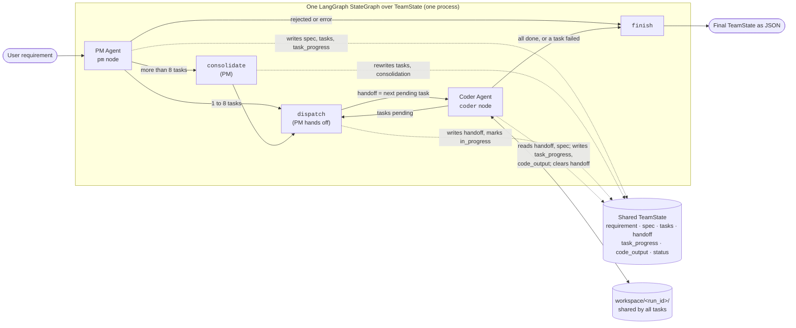

# Autonomous Multi-Agent Development Team

**Course:** Build Autonomous Multi-Agent Systems

The goal is a team of three LLM-powered agents that turn a plain-English software
requirement into tested, working Python code, with no human input after the first prompt:

1. **Product Manager (PM) Agent:** interprets the requirement, writes a technical
   specification, and breaks it into engineering tasks.
2. **Coder Agent:** implements the tasks as clean, modular Python and revises the code
   until every test passes.
3. **QA & Debugger Agent:** writes the automated tests, reviews the code for bugs and
   style problems, and sends findings back to the Coder.

The full specification, plan and task list are in `specs/001-autonomous-dev-team/`; the
PM → Coder handoff is defined in `specs/001-autonomous-dev-team/contracts/handoff-protocol.md`.

## Status: Increment 2, the PM and Coder agents as a team

The **PM Agent** and the **Coder Agent** now work together. The PM turns a requirement
into a specification and up to 8 ordered tasks, and the Coder builds them one at a time
in a shared workspace. The QA Agent, the Coder ⇄ QA loop, and run limits on time and
spend come in later increments.

## How the agents work together

Both agents are nodes in one LangGraph `StateGraph`, running in one process. They share a
single typed state, `TeamState` (`orchestration/state.py`), and talk only through it.



| State key | Written by | Read by |
|-----------|-----------|---------|
| `requirement` | `run_team` (input) | `pm`, `consolidate` |
| `spec`, `tasks` | `pm`, `consolidate` | `dispatch`, `coder`, `finish` |
| `handoff` | `dispatch` (sets), `coder` (clears) | `coder` |
| `task_progress` | `pm` (all pending), `dispatch`, `coder`, `finish` | routers, `dispatch` |
| `code_output` | `coder` (appends after each task) | caller |
| `consolidation` | `consolidate` | caller |
| `status`, `error`, `usage` | every node that changes them | routers, caller |

- **The handoff.** The PM side puts one task on the `handoff` state key: its ID, title,
  description, acceptance criteria and priority. The Coder takes it, builds it, writes the
  task's status and the code it wrote back into shared state, and clears `handoff`. Tasks
  go one at a time, in the PM's order; priority is shown to the Coder but never reorders
  tasks.
- **At most 8 tasks.** If the PM plans more than 8, it is asked once to merge them. Its
  merge is used only if it passes checks in code: 8 or fewer complete tasks, and every
  original acceptance criterion kept word for word and in order. Otherwise the system
  merges neighbouring tasks itself. Nothing loops back to the PM, so every run ends.
- **A failed task ends the run.** If the Coder cannot finish a task, that task is marked
  `failed`, the rest are marked `skipped`, and the code written so far is kept.

## Safety: where generated code runs

The Coder Agent runs the code it writes, and that code is untrusted. **It never runs on
your machine directly.** Every `exec_python` call starts a fresh, throwaway Docker
container that:

- has **no network** (`--network none`), so nothing can be downloaded or sent out;
- has **no secrets**: the only environment variables are two Python settings, and the
  agent's own process (which holds your API key) is not visible inside the container;
- sees **only that run's workspace** (`workspace/<run_id>/`, mounted at `/work`); the rest
  of the filesystem is the read-only sandbox image;
- runs as your user ID, never root, with all Linux capabilities dropped and
  `no-new-privileges`;
- is limited to 512 MB of memory, 1 CPU, and 128 processes, and is killed at the time
  limit (default 30 s);
- uses a Python 3.12 image pinned by digest, so it can't change underneath you.

If Docker is not available, the agent refuses to start rather than run code unsandboxed.
No container is given the Docker socket. The PM Agent runs no code.

## Setup

You need Python 3.12, Docker (your user must be able to run `docker`), and an Anthropic
API key.

```bash
python3.12 -m venv .venv
source .venv/bin/activate
pip install -r requirements.txt
echo 'ANTHROPIC_API_KEY=sk-ant-...' > .env
```

The first run pulls the sandbox image (`python:3.12-slim`, pinned by digest) and Chroma's
embedding model (about 80 MB, cached in `~/.cache/chroma`).

Chroma needs SQLite 3.35 or newer. On hosts with an older system SQLite (RHEL 8 ships
3.26), `agents/memory.py` switches to the bundled `pysqlite3-binary` build automatically.

## Usage

### The team (PM → Coder)

```bash
python -m orchestration.team "A command-line tool that converts temperatures between Celsius and Fahrenheit"
```

| Option | Meaning |
|--------|---------|
| `--max-steps N` | Maximum Coder model calls per task, 1 to 10 (default 10) |
| `--timeout SECONDS` | Seconds before a run of generated code is killed (default 30) |

Progress goes to stderr, one line per step:

```text
[pm] "Temperature converter": 3 tasks
[handoff] T1 (high) Convert a value between units
[step 1] write_file converter.py
[coder] T1 completed in 3 steps (41.2 s)
...
[finish] completed
```

The final `TeamState` is printed to stdout as JSON. The exit code is 0 if every task
completed, 1 for `failed`, `rejected` or `error`, and 2 for usage errors (an empty
requirement, a bad setting, or Docker not being available).

```python
from orchestration.team import run_team

state = run_team("A tool that prints the primes below 50")
print(state["status"], [task["title"] for task in state["tasks"]])
```

### The Coder on its own

```bash
python -m agents.coder_agent "Write fizzbuzz.py that prints FizzBuzz for 1 to 15"
```

It takes the same `--max-steps` and `--timeout` options, prints `[step N]` progress lines,
and prints its result as JSON. The exit code is 0 if the task completed, 1 for any other
outcome (`step_limit`, `refused`, `error`), and 2 for usage errors.

```python
from agents.coder_agent import CoderAgent

agent = CoderAgent()               # keeps short-term memory across run() calls
result = agent.run("Write primes.py that prints the primes below 50")
print(result.status, result.execution_result.stdout)
```

### What a team run returns (`TeamState`)

| Field | Meaning |
|-------|---------|
| `requirement` | The text you gave |
| `spec` | The PM's specification: `name`, `description`, `acceptance_criteria`, `assumptions`, `tasks` |
| `tasks` | The task list the Coder works through: `task_id`, `title`, `description`, `acceptance_criteria`, `priority` |
| `handoff` | The task currently handed to the Coder (`null` when the run ends) |
| `task_progress` | Per task: `status` (`pending`, `in_progress`, `completed`, `failed`, `skipped`), the Coder's status, summary, files written, steps used, `duration_seconds`, error |
| `code_output` | Each file each task wrote, with its contents |
| `consolidation` | Set when the PM planned more than 8 tasks: counts before and after, and whether the PM's merge or the fallback was used |
| `status`, `error` | `completed`, `failed`, `rejected` or `error`, and why |
| `usage`, `duration_seconds` | Tokens used by both agents, and the run's wall-clock time |
| `run_id`, `workspace` | The run's ID and the folder holding all of its code |

### What a Coder result contains

| Field | Meaning |
|-------|---------|
| `code` | Contents of the main file, read from disk |
| `explanation` | What the agent built |
| `plan` | The steps it actually took |
| `execution_result` | A real run of the main file: exit code, stdout, stderr, timeout flag |
| `status` | `completed`, `step_limit`, `refused`, or `error` |
| `steps` | Thought → Action → Observation trace, one entry per model call |
| `usage`, `duration_seconds` | Tokens used and wall-clock time for the run |

The contracts are in `specs/001-autonomous-dev-team/contracts/`.

### Configuration

All settings are optional environment variables (or `.env` entries):

| Variable | Default | Meaning |
|----------|---------|---------|
| `PM_MODEL` | `claude-sonnet-5-5` | PM model ID |
| `PM_EFFORT` | `high` | PM effort: `low`, `medium`, `high`, `xhigh`, or `max` |
| `PM_USE_FALLBACKS` | `true` | Retry PM requests the model declines on a fallback model |
| `CODER_MODEL` | `claude-sonnet-5-5` | Coder model ID |
| `CODER_EFFORT` | `medium` | Coder effort: `low`, `medium`, `high`, `xhigh`, or `max` |
| `CODER_MAX_STEPS` | `10` | Maximum Coder model calls per task (1 to 10) |
| `CODER_EXEC_TIMEOUT` | `30` | Seconds before generated code is killed |
| `CODER_WORKSPACE` | `workspace` | Folder for per-run workspaces |
| `CODER_CHROMA_PATH` | `.chroma` | Folder for long-term memory |
| `CODER_USE_FALLBACKS` | `true` | Retry declined Coder requests on a fallback model |
| `CODER_SANDBOX_IMAGE` | `python:3.12-slim@sha256:a6e3…` | Image that runs generated code; keep it pinned by digest |

## Tests

```bash
python -m unittest discover -s tests -t . -v
```

The suite runs offline, including every PM and team test (they use a fake model client and
a fake Coder). Tests that execute code need Docker and are skipped without it; the live
smoke test runs only when `ANTHROPIC_API_KEY` is set.

## Design decisions

- **Claude Sonnet 5.5 through the official `anthropic` SDK** for both agents, with
  adaptive thinking and server-side refusal fallback. The PM runs at `high` effort (one
  planning call per run); the Coder at `medium`.
- **LangGraph for both loops.** The team graph (`pm → consolidate → dispatch ⇄ coder →
  finish`) and the Coder's own four-node ReAct graph use only the core graph API, as the
  project constitution requires. The Coder's graph runs inside the team graph's `coder`
  node, in the same process, so its private message history stays out of shared state.
- **A typed shared state, no Pydantic.** `TeamState` and everything in it are `TypedDict`s
  with `Literal` value sets, so the state (and the handoff in particular) is plain JSON
  with no conversion step and no new dependency.
- **The handoff is a state key.** One `Task` on `handoff` means "ready for the Coder";
  only the PM side sets it and only the Coder clears it, so at most one task is in flight.
- **A checked task cap.** The PM's merge of an oversized plan is checked in code and
  replaced by a deterministic merge if it fails, so the 8-task limit and every acceptance
  criterion always survive.
- **One workspace per run**, shared by all tasks, so later tasks can build on earlier
  ones; each file's contents are read back from disk into `code_output`.
- **Append-only history.** Sonnet 5.5 rejects requests whose earlier messages were edited,
  so the Coder's system prompt and tools never change within a run, and memories are added
  as new system messages instead of being written into the system prompt.
- **Two-tier memory.** A 5-task sliding window is shown at the start of each Coder run,
  and a persistent Chroma store (with Chroma's built-in embeddings, so no extra API key)
  is searched before every model call in the loop.
- **Ground truth over claims.** `code`, `execution_result` and `code_output` come from the
  files on disk and real runs, never from what the model says it did.
- **A sandbox container per code run** rather than a subprocess on the host: a subprocess
  shares your user, files and network, and can read the agent's environment (including
  the API key) through `/proc`.
- **Minimal dependencies:** `anthropic`, `langgraph`, `chromadb`, `python-dotenv`, plus
  `pysqlite3-binary` only for hosts with an old SQLite; everything else is the standard
  library, and tests use `unittest`.

## Project layout

```text
orchestration/state.py  Shared TeamState schema (TypedDicts) read and written by both agents
orchestration/team.py   Team graph: PM and Coder nodes, handoff, task cap, run_team, CLI
agents/pm_agent.py      PM Agent: spec and task writing, checked consolidation, merge fallback
agents/coder_agent.py   Coder Agent: config, result types, LangGraph loop, CLI
agents/llm.py           Claude request settings shared by both agents
agents/memory.py        Sliding-window and Chroma memory
tools/                  read_file, write_file, exec_python (sandboxed), and the dispatcher
tests/                  unittest suite (offline tests plus one live smoke test)
specs/                  Specification, plan, research, contracts, and tasks
```

The Lab 1.1 starter files (`agent.py`, `memory.py`, `test_memory.py`) and the `openai`
dependency were retired in Increment 1; they can be recovered from the initial commit.
